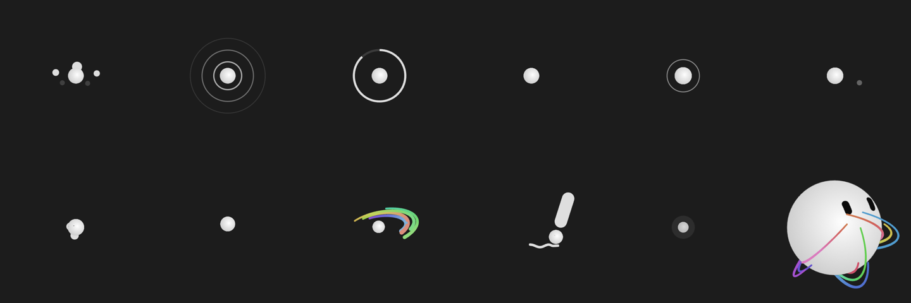

# GrokSpot

[日本語](README.md) | **English** | [中文](README.zh-CN.md)

An Android app that turns an Echo Spot (Amazon's round-screen device from 2017) into a **dedicated GrokBot device that answers you with a face**.
It runs on an Echo Spot with LineageOS and talks with you by voice through xAI's Grok Voice API.

> **This is an unofficial project.** It is not affiliated with or endorsed by xAI or Amazon.
> "Grok" is a trademark of xAI, and "Echo Spot" is a trademark of Amazon.

<p align="center">
  
</p>



## Why I made it

- While looking at GrokBot's avatar, I wondered how it would look on an Echo Spot. I ordered a used one, and its mute button symbol looked like Grok. After that I couldn't think of any other use for it.
- **To give an AI a face.** With a voice-only AI it is hard to tell whether it is listening, thinking or done talking. The face shows that with expressions and movement.
- **To make it feel alive.** It is never a still picture while idle: it looks around, dozes off, and sleeps at night. It reacts when you touch it.

## Features

| Feature | What it does |
|---|---|
| Voice conversation | Press the button on top (originally the mic-off button) to talk with Grok Voice. With search turned on, Grok searches the web and X to answer things like the weather or news. Press again, or stay silent for 60 s, to end |
| Expressions that follow the talk | Shows how the conversation is going (listening → thinking → speaking → idle) with its face. Grok sometimes picks an expression itself |
| "Your turn" cue | When you can speak, the edge of the screen glows blue and a hint appears |
| Life while idle | Keeps making small gestures while resting, and strings together looking around, thinking, humming, doodling, playing and trying out morphs, a little differently each time. Its mood and energy change what it picks; once in a while it sneezes or dances alone. At night it sleeps until morning |
| Touch | Eyes and head follow your finger. Patting the top of the head, poking an eye, poking the body, touching empty space and rapid tapping each get a different reaction |
| Control from GrokBot (MCP) | A built-in MCP server (port 8765) offers the tools `set_avatar_state` (an emoji that fits the state appears at the bottom of the screen) and `get_avatar_state`, so GrokBot on your phone or PC can move the face. See [docs/MCP.md](docs/MCP.md) (Japanese) |
| Morphs and effects | 14 morphs such as the thinking "...", the warning "!", a radar, a progress ring and a pen, plus confetti and rainbow trails |
| A dedicated device | Starts as the home app. The screen turns off in a dark room and back on when it gets bright. Hold the button for the power menu |
| Voice and colours | Pick Grok's voice (eve, iris and more) and the face, eye and background colours per device — e.g. a pink face on white for a white Echo Spot |

Screenshot: life while idle (play → hum → drowsy → sleep → wake up)


## Requirements

- An **Echo Spot (1st generation, 2017)** running **LineageOS 18.1 (Android 11)**.
  This is an unofficial port. The **overall flow and the common pitfalls** are summarized in sections A and B of [docs/SETUP.md](docs/SETUP.md) (Japanese; the steps I actually followed on two devices). The XDA threads below are the authoritative and up-to-date source. **Modifying the device may not be reversible; do it at your own risk.**

  Where to look (unofficial):
  - Unlock and TWRP: [XDA - UNLOCK/ROOT/TWRP for Echo Spot 2017 (rook)](https://xdaforums.com/t/unlock-root-twrp-unbrick-amazon-echo-spot-2017-rook.4754878/)
  - LineageOS 18.1 ROM: [XDA - LineageOS 18.1 for the Amazon Echo Spot (2017)](https://xdaforums.com/t/rom-unofficial-11-rook-lineageos-18-1-for-the-amazon-echo-spot-2017.4762459/)
  - Build downloads: [amazon-oss/releases](https://github.com/amazon-oss/releases/releases/tag/lineage-18.1-rook-v0.3)
- A Windows PC (the scripts are for PowerShell; the Android build itself also works on macOS / Linux)
  - Android Studio (its bundled JDK and the Android SDK)
  - Node.js (only if you modify the face drawing library; a prebuilt copy is included, so you normally don't need it)
  - adb (Android SDK Platform-Tools)
- An **xAI API key** (Grok Voice is billed by usage; see "[Grok Voice pricing and search](#grok-voice-pricing-and-search)" below)

The detailed docs under `docs/` and the messages the scripts print are in Japanese. The app's screen and settings texts switch between Japanese, English and Chinese with the device language, and Grok answers in whatever language you speak.

## Quick start

The full steps are in [docs/SETUP.md](docs/SETUP.md) (Japanese). In short:

```powershell
# 0. Install LineageOS on the Echo Spot and turn on USB debugging (sections A and B of SETUP.md)
git clone https://github.com/shibainu-inu/grokspot.git
cd grokspot

# 1. Build the app and install it on the Echo Spot (the face drawing library is included prebuilt)
.\gradlew.bat :app:installDebug

# 2. Copy your API key to the clipboard, then write it to the device
powershell -ExecutionPolicy Bypass -File scripts\set-api-key.ps1

# 3. Turn on the button service and make it the home app (steps 5–7 in SETUP.md)

# 4. Set the display language and time zone (B-5 or step 8 in SETUP.md). Grok answers in the language you speak

# 5. Optionally, change the voice and colours (step 9 in SETUP.md)
powershell -ExecutionPolicy Bypass -File scripts\set-voice.ps1 iris
powershell -ExecutionPolicy Bypass -File scripts\set-face-color.ps1 pink -Eye white -Background white
```

> **Tip**: Doing this with an AI coding tool such as Claude Code on your PC, with the Echo Spot connected over Micro USB, makes building and tweaking much easier. Give it the setup guide and it runs the `adb` commands step by step; tweaks like "make the face light blue" or "change the voice" are small changes to the scripts and settings it can make for you. See "Tips" in [docs/SETUP.md](docs/SETUP.md).

### Grok Voice pricing and search

Talking with the button (Grok Voice) is billed by usage on xAI's API. Prices can change, so check [xAI's pricing page](https://docs.x.ai/docs/models) before you start (the figures below are from October 2026).

| Item | Approximate price |
|---|---|
| Grok Voice (voice conversation) | $0.08 per minute ($4.80 per hour) |
| Web search | About $5 per 1,000 searches (about $0.005 each) |
| X search | About $5 per 1,000 searches. Some reports say it changed to pricing by the number of posts and profiles fetched, which can make a single search cost more |

- A conversation is connected only from the button press until you press again or it closes after 60 s of silence. Nothing is billed while it is not connected.
- Most of the cost depends on how long you talk. Search tends to make answers longer, which adds to the voice cost.
- If you are worried about spending, check your usage or set a limit in the xAI console.

**Search is off at first.** You can talk without it, but Grok can't answer about recent things such as weather or news. To turn it on, run one of these from your PC (it takes effect from the next conversation):

```powershell
powershell -ExecutionPolicy Bypass -File scripts\set-voice-search.ps1 -Web        # web search only (recommended)
powershell -ExecutionPolicy Bypass -File scripts\set-voice-search.ps1 -Web -X     # X search as well
powershell -ExecutionPolicy Bypass -File scripts\set-voice-search.ps1 -Off        # turn it off again
powershell -ExecutionPolicy Bypass -File scripts\set-voice-search.ps1             # show the current setting
```

With search on, Grok searches by itself when it needs to, then answers. While it searches, the face shows its "searching" expression.

### Move the face from your own GrokBot (optional)

You can also move the face from Grok on your phone or PC (grok.com). The app opens a tunnel with your own ngrok account to publish the Echo Spot's MCP server, and you register that URL as a custom connector in Grok. No PC has to keep running, and no shared relay server is involved.

The details (ngrok setup, registering the connector, approving with the 6-digit code that appears when you touch the screen, and instructions to give Grok) are in [docs/MCP.md](docs/MCP.md) (Japanese; the suggested Grok instructions are given in English too).

Once approved, ask Grok to "make the Echo Spot's face curious" and the face on the screen changes. Authorization is OAuth 2.1 and is approved with a code that appears when you touch the Echo Spot's screen, so only someone in front of the Echo Spot can approve it.

## Layout

```
app/src/main/java/com/grokbot/grokspot/
  MainActivity.kt        Full-screen WebView. The button starts and ends a talk; holding the face for 5 s opens Settings (escape hatch)
  VoiceSession.kt        Conversation with Grok Voice (wss://api.x.ai/v1/realtime): mic upload, audio playback, events
  McpServer.kt           MCP server (Streamable HTTP, port 8765). Tools set_avatar_state / get_avatar_state
  McpAuth.kt             OAuth 2.1 for MCP (approved with the code on the screen)
  NgrokTunnel.kt         Opens the ngrok tunnel to the MCP server inside the app (reconnects as soon as Wi-Fi is back)
  GrokButtonService.kt   Accessibility service: button presses (press, double press, hold) and screen off/on in a dark room
app/src/main/assets/web/
  index.html             The face page, with the input ring and text
  i18n.js                Screen texts (Japanese, English, Chinese)
  grokbot.js             Face drawing library (grokbot-web built with added features)
  motion.js              Body movement, blinking, gaze and the 14 morphs
  fx.js                  Confetti, rainbow trails and drawing of morph parts
  actions.js             Actions such as "listen" and "think" → expressions
  voice.js               Conversation events → expressions (spec: docs/AVATAR-STATE-SPEC.md)
  external.js            States from MCP → expressions, the emoji at the bottom, the edge glow
  pairing.js             Shows the OAuth code on the screen
  life.js                Life while idle (energy, day and night)
  touch.js               Reactions by touch position
device/
  Vendor_2454_Product_6500.kl   Key layout that turns the mic-off button into the Grok button
scripts/
  build-web.ps1          Rebuilds grokbot.js after you modify the drawing library (normally not needed)
  set-api-key.ps1        Writes the API key into the app's private storage on the device
  set-voice-search.ps1   Turns Grok Voice search (web, X) on or off (off by default)
  set-mcp-token.ps1      Manages MCP auth (show or remake the token, revoke OAuth approvals)
  mcp-call.ps1           Calls the MCP server from your PC to check it works
  set-ngrok.ps1          Writes the ngrok authtoken and domain so the app opens the tunnel
  set-voice.ps1          Picks the Grok Voice voice (eve by default)
  set-face-color.ps1     Picks the face, eye and background colours (white face, black eyes, black background by default)
docs/ (Japanese)
  SETUP.md               Detailed steps from preparing the device to installing
  DESIGN.md              Design intent and how it works
  AVATAR-STATE-SPEC.md   Spec of avatar state changes during a conversation (Grok Voice API version)
  MCP.md                 Using the MCP server and registering it with GrokBot
```

The design thinking (why expressions are passed by function calls, why you can't interrupt during a reply, and so on) is in [docs/DESIGN.md](docs/DESIGN.md), and the avatar's state changes during a conversation are in [docs/AVATAR-STATE-SPEC.md](docs/AVATAR-STATE-SPEC.md), a spec written together with Grok.

## Known limitations

- **You can't interrupt Grok while it speaks.** The Echo Spot has no echo canceler, so the mic audio is not sent while Grok is talking.
- **Display languages are Japanese, English and Chinese (Simplified).** The screen texts and the settings texts follow the device language (English for any other language). Grok answers in the language you speak to it. To add a language, add it to `res/values-xx/strings.xml` and `assets/web/i18n.js`.
- **The API key is stored on the device in plain text.** It is meant for a dedicated device used by one person. The key is kept in the app's private storage (other apps can't read it) and is never in the APK or the repository.
- It assumes a debug build (writing the API key uses `run-as`).
- Not tested on devices other than the Echo Spot (LineageOS 18.1).

## Credits and license

- The face is drawn with [grokbot-web](https://github.com/Coiggahou2002/grokbot-web) (BSD-3-Clause), a port of [nasawz/GrokBot](https://github.com/nasawz/GrokBot) (Flutter, BSD-3-Clause). The design of the expressions, shapes and states belongs to the original author.
  The bundled copy is a **modified** build of grokbot-web with features added for GrokSpot (eyelids, winks, eye spacing, a frame-rate cap and more). The list of added features is in step 1 of [docs/SETUP.md](docs/SETUP.md).
- The body movement (motion.js) is my own implementation, based on the avatar behavior described in xAI's article [Designing Grok Bot](https://x.ai/news/designing-grok-bot).
- License notices for bundled and dependent software are in [THIRD_PARTY_NOTICES.md](THIRD_PARTY_NOTICES.md).
- GrokSpot itself is [BSD-3-Clause](LICENSE).
