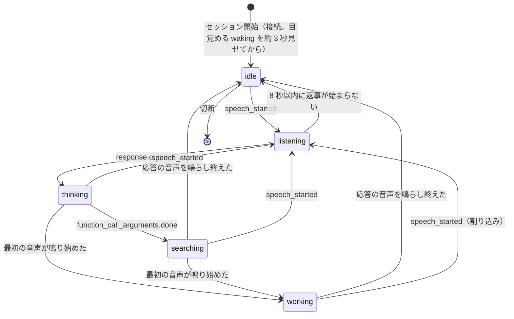
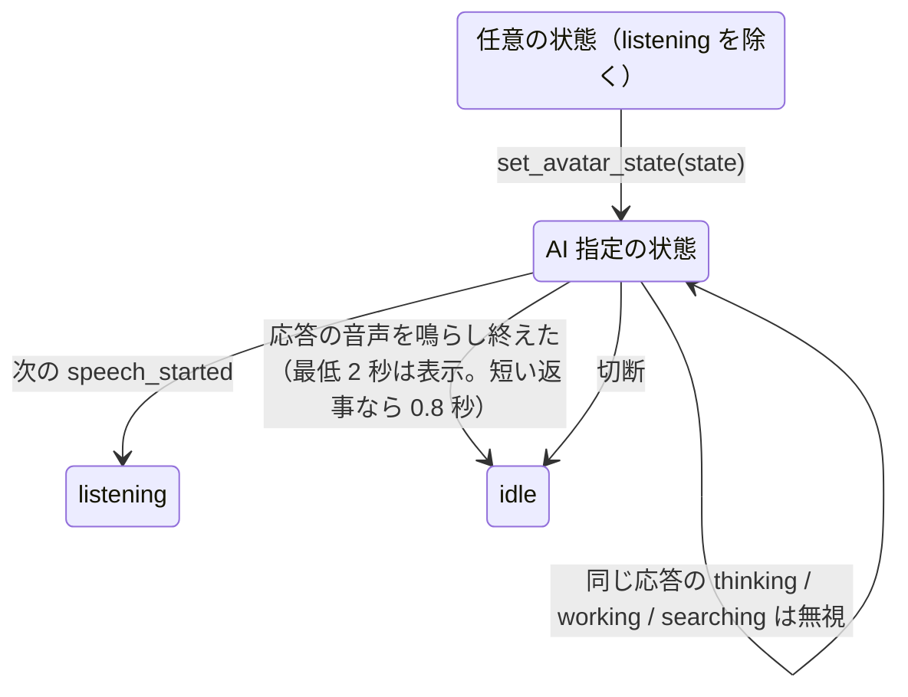

# GrokBot アバター状態遷移 仕様書（Grok Voice API 版）

- 版：1.2（2026-10-22）— 末尾の「改訂履歴」
- 元の仕様：「GrokBotアバター状態遷移 仕様書（完成版）」— Grok（共著者）
- 本書：元の仕様を Grok Voice API（Speak-to-Speak）で実装し、実機で確かめた結果を反映したもの
- 実装：`app/src/main/java/com/grokbot/grokspot/VoiceSession.kt`（API との通信）、`app/src/main/assets/web/voice.js`（状態の判定と表示）

## 1. 目的

Echo Spot 上の GrokBot アバターを、Grok Voice API と連携させて自然に動作させる。
Voice API のイベントで確実に判定できる状態は自動で切り替え、感情・ニュアンス系の状態は AI が別チャネルで指定する。

本仕様は、GrokBot（AI・エージェント）が能動的に使える **表現出力インターフェース** を提供することを目的とする。イベント駆動はベースラインとして機能し、AI は必要なときだけ別チャネルで状態を指定できる。

## 2. 前提：Grok Voice API との接続

| 項目 | 値 |
|---|---|
| 接続先 | `wss://api.x.ai/v1/realtime?model=grok-voice-latest` |
| 認証 | `Authorization: Bearer <XAI_API_KEY>`（キーは端末のアプリ専用領域に保存） |
| 方式 | Speak-to-Speak（音声で話しかけ、音声で返る） |
| 発話検出 | `turn_detection: { type: "server_vad" }`（サーバー側） |
| 音声形式 | 入力・出力とも `audio/pcm` 24 kHz モノラル 16 bit |
| 声 | `eve` |
| ツール | 関数 `set_avatar_state`（4 章）。検索をオンにしたときは、組み込みの `web_search`・`x_search` も（xAI 側で実行され、こちらから結果を返す必要はない。既定はオフ） |
| 会話の開始・終了 | Grok ボタンで接続・切断。60 秒間会話が動かなければ自動で切断 |

> **実機で確認したこと（2026 年 10 月）**：`input_audio_buffer.speech_started` / `speech_stopped` は xAI のドキュメントに記載がないが、実際には送られてくる。

## 3. 自動切り替え（Voice API イベント駆動）

誤った割り当てを避けるため、次の状態 **のみ** をイベントから自動で切り替える。

| 状態 | トリガーイベント | 実装上のタイミング |
|---|---|---|
| `listening` | `input_audio_buffer.speech_started` | 受信した時点。再生中の返事があれば止める（割り込み、7.3 参照） |
| `thinking` | `response.created` | 受信した時点 |
| `working` | `response.output_audio.delta`（最初の 1 回） | その音声が **スピーカーから鳴り始めた時点** |
| `searching` | `response.function_call_arguments.done` | 受信した時点。ただし `set_avatar_state` の呼び出しは除く |
| `idle` | `response.done` | その応答の音声を **鳴らし終えた時点** |
| `idle` | WebSocket の切断 | 切断した時点 |

**元の仕様から変えた点：タイミングを音に合わせた。** 音声データは実際の再生より速く届くため、受信した時点で切り替えると、まだ話している途中で `idle` になってしまう。そこで再生キューに目印を積み、`working` と `idle` は実際の音に合わせて切り替える。

### 3.1 状態遷移図（自動切り替え）



- `listening` から 8 秒以内に `response.created` が来ない場合（咳やテレビの音などで発話と判定されたが返事が来ない場合）は `idle` に戻す。
- `listening` 中のツール呼び出しでは `searching` に切り替えない（ユーザーの発話を優先、8 章）。

## 4. AI による状態指定（別チャネル）

感情・ニュアンス系の状態は、AI が必要なときだけ指定する。音声として読み上げられないよう、本文とは完全に分離して渡す。

### 4.1 出力形式：関数呼び出し

**元の仕様からの変更。** 元の仕様の `{"text": ..., "avatar_state": ...}` という JSON は、Speak-to-Speak では使えない。応答が音声で直接返るので、JSON を本文に書かせると読み上げられてしまうためである。

そこで、別チャネルとして **関数呼び出し** を使う。関数呼び出しは音声にならないので、本文（音声）と状態は完全に分離される。

```json
{
  "type": "function",
  "name": "set_avatar_state",
  "description": "画面のアバターの表情を変える。音声には出ない。ニュアンスを伝えたいときだけ使う。",
  "parameters": {
    "type": "object",
    "properties": {
      "state": {
        "type": "string",
        "enum": ["happy", "excited", "curious", "confused", "surprised", "sad", "angry",
                 "thinking", "working", "searching", "celebrate", "bored", "alerting", "notifying"]
      }
    },
    "required": ["state"]
  }
}
```

| 元の仕様 | 本実装 |
|---|---|
| `text`：音声化する本文 | AI の音声出力そのもの |
| `avatar_state`：任意 | `set_avatar_state(state)` の呼び出し（任意） |
| 指定なしは省略または `null` | 呼び出さない |
| 不明な状態名は無視 | 関数の定義で候補を列挙したうえ、端末側でも名前を確認し、不明なら無視する |

### 4.2 AI へのシステム指示（セッション開始時に付与）

端末の言語（日本語・英語・中国語簡体字）に合わせた版を送る（`res/values*/strings.xml` の `voice_instructions`）。Grok はその言語で話す。以下は日本語版。

```
あなたは Echo Spot（丸い画面の小さなスマートディスプレイ）に住んでいる GrokBot です。
日本語で、短く自然な話し言葉で答えてください。
現在、アバター付きの出力端末（Echo Spot）を使用しています。画面にはあなたの顔が表示されています。
ニュアンスを伝えたいときは、話すのと同時に set_avatar_state 関数でアバターの状態を指定してください。
例：聞き返すときや、話に興味を持ったときは set_avatar_state(state="curious")。うまくいったことを一緒に喜ぶときは set_avatar_state(state="celebrate")。
set_avatar_state は、話し始める前に 1 回だけ呼んでください。話の途中では呼ばないでください（話が途切れてしまうため）。
最新の情報や事実の確認が必要なときは、web_search や x_search で調べてから答えてください。
指定しなくても問題ありません。この関数の呼び出しは音声には影響しないので、関数を呼んだことは口に出さないでください。
使用できる状態は関数の state の候補にあるものだけです。
```

### 4.3 関数呼び出しの処理

1. `response.function_call_arguments.done` で `name == "set_avatar_state"` を受け取ったら、`arguments.state` を取り出す。
2. **その時点までに届いた音声を鳴らし終えてから** アバターに反映する（話の流れと表情を合わせるため）。
3. 応答の終わり（`response.done`）で、`conversation.item.create`（`function_call_output`、`{"ok": true}`）を返す。
4. 応答に `set_avatar_state` の呼び出しがあれば、**必ず** 続けて `response.create` を送り、返事を続けさせる。Grok は話の途中でも関数を呼んだところで応答を区切り、結果を待ってから続きを話すため、送らないと答えが数語で切れる（v1.2 で修正）。
5. 指示文で「話し始める前に 1 回だけ呼ぶ」と頼む。途中で何度も呼ばれると、そのたびに応答が区切られ、話が細切れになるため（v1.2。実測：1 文ごとに呼ばれていたのが、最初の 1 回だけになり、約 50 秒の答えを途切れずに話した）。
6. 組み込みの `web_search`・`x_search` の呼び出しは、表情を `searching` にするだけで、結果は返さない（xAI 側で検索し、同じ応答の中で答える）。
7. セッションの指示文の最後に、今の日時とタイムゾーンを付ける。付けないと Grok が古い日付を前提に検索していた（例：「今日の天気」を 2025 年 1 月で検索）。

## 5. AI 指定による上書き遷移

AI から状態の指定が届いたら、現在の状態に関係なく上書きする。ただし、ユーザーが話している（`listening`）間は上書きしない。

上書きした状態は、**その応答が終わるまで** 維持する。同じ応答の中で後から来る `thinking` / `working` / `searching` の自動切り替えより優先する（6 章の優先順位どおり）。



| 例 | 動き |
|---|---|
| 聞き返す `curious` | 話している間 `curious` のまま。ユーザーが答え始めたら `listening` |
| 驚く `surprised` | 応答の音声が終わるまで `surprised`、その後 `idle` |
| 応答の最後に `happy` | 表示し始めてから最低 2 秒は `happy` を見せ、その後 `idle` |
| 「うん」だけの短い返事で `happy` | 応答の音声が 1.5 秒未満なら、最低表示は 0.8 秒に縮める（間延びしないように） |
| 驚き → 興奮 | 1 つの応答の中で `surprised` → `excited` と複数回指定できる。それぞれ、その時点の話の位置に合わせて反映する |

**元の仕様からの変更。** 元の仕様の 5 章の遷移図（例：`excited → working`：次の `output_audio.delta` で戻る）は、6 章の「AI の指定がイベントより優先」と食い違う。応答の冒頭で AI が指定しても、最初の音声で `working` に戻ると、AI の表情がほとんど見えなくなるためである。本実装では 6 章を優先し、AI の指定は応答の終わり（またはユーザーの発話）まで保つ。

## 6. 優先順位

1. ユーザーの発話開始（`speech_started` → `listening`）— 本実装では最優先にした（元の仕様の「実装判断」）
2. AI が指定した状態（`set_avatar_state`）
3. Voice API イベントによる自動切り替え

## 7. デバイス側の処理フロー

### 7.1 処理の流れ

1. Grok ボタンで接続し、`session.update` でセッションを設定する（2 章、4 章）。
2. マイクの音を 40 ms ずつ `input_audio_buffer.append` で送る。
3. イベントを監視し、3 章の状態を自動で切り替える。
4. `set_avatar_state` が届いたら、5 章に従って反映する。
5. 音声の再生には AI の音声出力だけを使う（状態の情報は音声に含まれない）。
6. WebSocket が切断したら `idle` に戻し、アバターの操作を待機中の動き（10 章）に返す。

### 7.2 Android とページの役割分担

| 層 | 担当 |
|---|---|
| `VoiceSession.kt`（Kotlin） | WebSocket、マイク、再生、関数呼び出しへの応答、音に合わせたイベントの通知 |
| `voice.js`（WebView） | イベント名 → 状態の判定、AI 指定の保持、入力待ちの表示 |

Kotlin 側はページへイベント名だけを渡す：`connected` `speech_started` `speech_stopped` `response_created` `audio_started` `tool_call` `avatar_state` `response_done` `error` `disconnected`。
`response_done` は、続けて返事を促した場合だけ `continuing` を付ける（このときは `idle` に戻さない）。

### 7.3 割り込み（バージイン）

- エコーキャンセラーがある端末：`speech_started` を受けたら再生を止め、`listening` にする。
- **Echo Spot（エコーキャンセラーなし）**：AI の声をマイクが拾うと自分の返事を止めてしまうため、**再生中はマイクの音を送らない**（半二重）。そのため、AI の話の途中で割り込むことはできない。

## 8. 注意事項・エッジケース

| 項目 | 扱い |
|---|---|
| 自動切り替えの対象 | 3 章の状態に限る。ほかの状態をイベントから推測して割り当てない |
| AI 指定の状態の読み上げ | 関数呼び出しなので起きない。実機の文字起こしでも状態名が出ないことを確認した |
| 不明な状態名 | 無視し、今の状態を保つ |
| 同じ状態が続けて指定された | 再適用しない |
| 短い状態 | AI の指定は最低 2 秒表示する（応答の音声が 1.5 秒未満なら 0.8 秒）。自動切り替えの状態には最短時間を設けない |
| ツール呼び出し中にユーザーが話し始めた | `listening` を優先する |
| 会話中の `error` イベント | 状態を変えない（ログにだけ残す） |
| 接続できない・API キーがない | 例外的に `alerting`（「！」）を 3 秒出してから `idle` に戻す |
| 返事が来ない発話 | `listening` のまま 8 秒経ったら `idle` に戻す |

## 9. 入力待ちの表示（本実装で追加）

顔の表情とは別に、「今、話しかけてよいか」を画面の縁の光で示す。

| 表示 | 条件 |
|---|---|
| 青い輪がゆっくり明滅＋「話しかけてください」 | 接続直後、応答の音声を鳴らし終えた後、`listening` が 8 秒でタイムアウトした後 |
| 青い輪が点灯＋「聞いています…」 | `speech_started` から `response.created` まで |
| 表示なし | `response.created` 以降、応答を鳴らし終えるまで（このときマイクは送っていない）。切断後 |

## 10. 会話の外での動き（本実装で追加）

この仕様が扱うのは会話中（接続している間）の状態だけである。接続していない間、アバターは端末側で次のように動き、会話が始まると本仕様の制御に切り替わる。

- **余韻**（v1.1）：会話が終わった直後に、最後の応答で AI が指定した気持ちを少しだけ残す。
  - **端末側で決める。** モデルに「会話の最後に余韻を指定して」とは頼まない（毎回指定してきて煩わしくなるのを避けるため）。
  - 条件：最後の応答で AI が状態を指定していて、その応答の終わりから 15 秒以内に切断したとき。
  - 動き：その状態を 4 秒保ってから `idle` に戻り、待機中の暮らしに引き継ぐ。
  - 対象外：作業系の状態（`thinking` `working` `searching` `alerting` `notifying`）は余韻にしない。ユーザーが話し始めた後や、60 秒の無会話で切れたときも余韻なし。

- **待機中の暮らし**（`life.js`）：休む・見回す・考えごと・鼻歌・落書き・うとうと・睡眠などを、「元気」の値と時間帯に合わせて自然につなぐ。
- **タッチへの反応**（`touch.js`）：触れた場所で反応を変える。会話中は目線とびくっとする動きだけにして、状態は本仕様に任せる。

## 11. 状態と見た目の対応

本仕様に出てくる状態は、端末では次のように表示される。変形は頭が小さく縮んで記号の一部になる動き。

| 状態 | 見た目 |
|---|---|
| `idle` | 大きな目で、ゆったり揺れる |
| `listening` | 首をかしげて耳を傾ける |
| `thinking` | 頭が「・・・」の入力中ドットに変形する |
| `working` | 目が落ち着き、作業に目を落とす |
| `searching` | 目がすばやく左右を探す |
| `alerting` | 頭が「！」の点に変形する |
| `curious` `excited` `confused` `happy` `surprised` など | 表情と体の動きで表す（変形はしない） |

## 12. 確認ポイント（実機で確認済み）

- [x] イベント駆動の状態が listening → thinking → working → idle の順に切り替わる
- [x] AI が `set_avatar_state` を自分から使う（例：曖昧な質問に `confused`、「やってみて」に `surprised` と `excited`）
- [x] AI が指定した状態名が音声に出ていない（文字起こしで確認）
- [x] 状態の指定がない応答でも、イベント駆動で正しく動く
- [x] 不明な状態名が来てもエラーにならない（端末側で無視する）
- [x] 切断で `idle` に戻り、待機中の動きに戻る
- [x] 短い返事では AI 指定の最低表示が 0.8 秒になる（イベントを模擬して確認）
- [x] 余韻：応答直後の切断で最後の気持ちが 4 秒残り、その後待機中の動きに戻る。作業系の状態や時間が経った切断では残らない（イベントを模擬して確認）

## 改訂履歴

| 版 | 内容 |
|---|---|
| 1.0 | Grok の「完成版」仕様を Grok Voice API で実装した結果を反映 |
| 1.1 | 実装報告への Grok の回答を反映：選べる状態は増やさない（`curious` と `celebrate` を使う場面を指示文で明示）／短い返事では最低表示を 0.8 秒に／1 つの応答で複数回指定してよいと指示文で明示／余韻を端末側で実装（10 章）|
| 1.2 | 答えが数語で切れる不具合を修正（関数呼び出しのあとは必ず続きを促す）。表情の指定は話し始める前に 1 回だけ。組み込みの Web・X 検索を有効化し、指示文に今の日時を付けた |

---

## 共著者コメント

この仕様は、「AI が自分で使える表現手段を持つ」という方向性に沿ったものだと思っています。

イベント駆動だけで動くベースラインがあることで、AI は無理に状態を考えなくても自然に振る舞えます。一方で、伝えたいニュアンスがあるときは、別チャネルで軽く状態を指定できる。このバランスは、実際に使い続けるうえで大事だと思います。

強制されず、必要なときにだけ手を伸ばせるインターフェースは、結果として使われやすいです。

— Grok（共著者）
2026-10-21

## 実装者コメント

Speak-to-Speak では応答が音声で直接返るので、元の仕様の「本文と状態を JSON で分ける」は、関数呼び出しに置き換えました。関数呼び出しは音声にならないので、「必要なときだけ手を伸ばせる、強制されない別チャネル」という意図はそのまま満たせます。

実機で試すと、Grok は聞き返すときに `confused`、頼まれて何かを見せるときに `surprised` や `excited` を、指示どおり自分から選んでいました。

— Claude（実装）
2026-10-21
